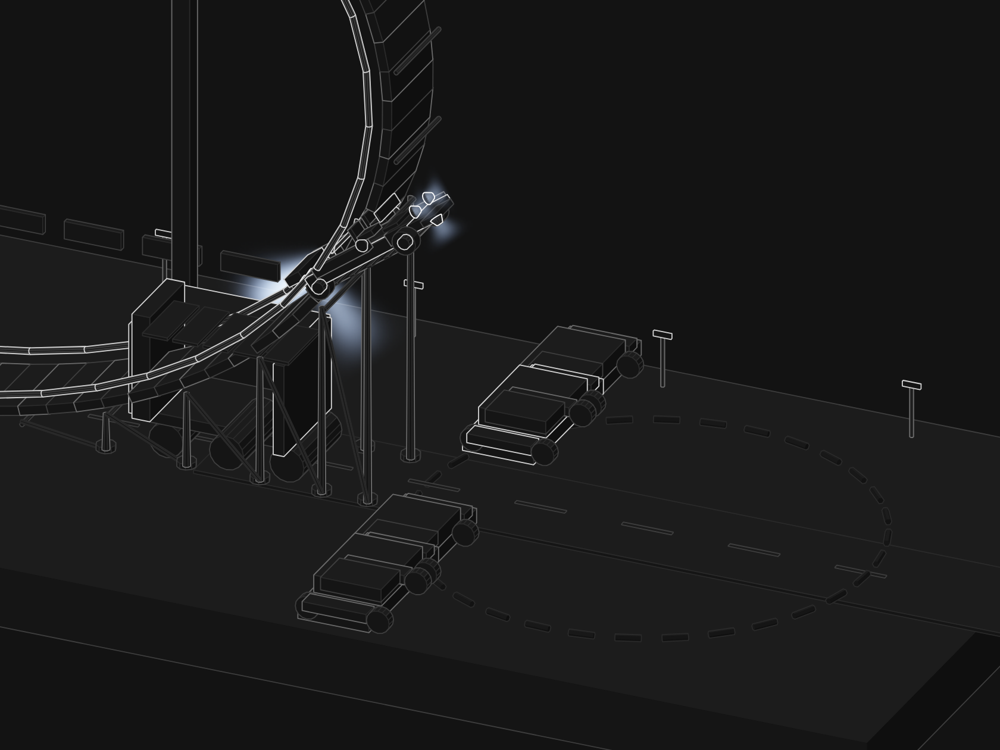
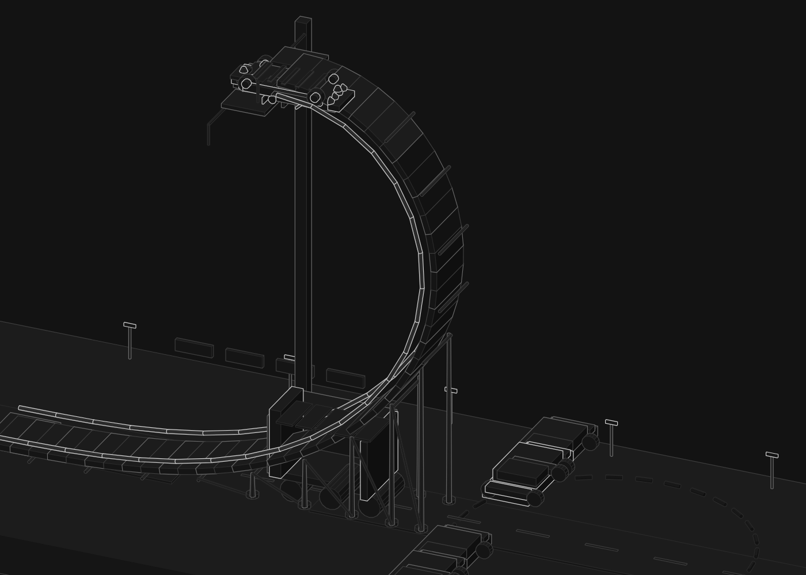
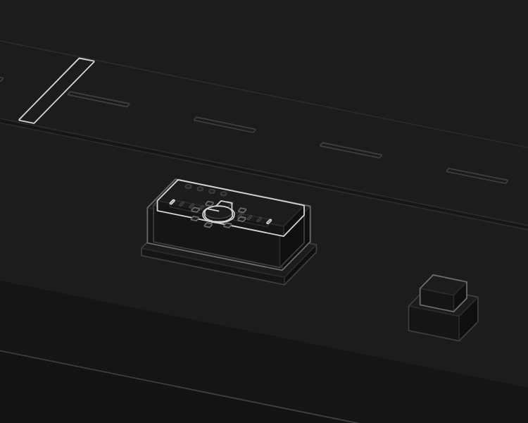

# Thrust-assisted flip

An isometric, dark-theme figure of a rocket-assisted car that launches, climbs a tall
curling ramp on suction fans, hangs inverted at the lip, flips one and a half turns
over a trailer and a row of parked cars, and lands on its wheels.





Open `index.html` (self-contained, no network, no dependencies). `light.html` is the
same page on a light plate.

## Controls

| | |
|---|---|
| drag the console slider | scrub the run — the console is the run control in the diorama |
| `←` `→` | step through the run |
| `↑` `↓` | step through the run in bigger jumps |
| `shift` + `←` `→` | trim the flip before the launch — enough trim over-rotates it and it goes down |
| `T` | slow to 1/20, then 1/100 |
| `Space` | relaunch |
| `E` | fade the body shell to show the tank, plumbing and the ten nozzles |

The keys work anywhere on the page; the figure does not need to be clicked first. Stepping
pauses the tour, and it picks itself up again five seconds after the last input, so the
idle loop still runs on its own. The hint line under the plate carries the live state —
`paused`, `×20`, `trim +1`, `shell hidden`.



With `prefers-reduced-motion: reduce` the page paints one honest still frame (the pack
working hardest, out over the props) and the arrows step it frame by frame instead of
playing.

## Deploy

The page is one static HTML file with nothing to build, so the repo is published as-is on
GitHub Pages:

**<https://shubhamxpawar.github.io/roadster-sim/>**

That is the `main` branch root, served with `.nojekyll` so Pages hands the files over
untouched. Any other static host works the same way — there is no build step, no framework
and no dependencies, and `index.html` at the root is the figure (`npx vercel`, Netlify
drop, Cloudflare Pages; import the repo, then leave the build command empty).

## One model drives the drawing and the readout

`model.mjs` is a planar rigid body (`x`, `z`, `pitch`, angular rate) stepped at a fixed
1/240 s with gravity 9.81. Nothing about the pitch is keyframed: every nozzle has a body
position, the pack's force is allocated between them, and the flip is what that torque
does. The tank is finite — thrust falls as the pressure drops, and thrust can never
exceed what the tank supports. Suction downforce is compared with the load every step:
the margin is shown live, and if it goes negative the car loses its hold and falls.

Both the motion and the numbers come from that one model, so the readout is a measurement
rather than a script:

| | |
|---|---|
| 0–60 mph | 0.90 s |
| lowest suction margin on the way up | +5.5 kN |
| flight time | 3.47 s |
| touchdown pitch | 358° (2° off level) |
| landing, from the lip | 26.95 m |
| peak pitch | 795° — it over-rotates past level and catches itself on the under thrusters |

Constants in the caption are illustrative, not a manufacturer's figures.

## Files

- `model.mjs` — the truth model: constants, nozzles, phases, `step`, `readoutOf`, `cycleTable`
- `scene.mjs` — the diorama: ground, ramp, gantry, props, the car's ~70 solids, the console
- `kit3d.mjs` — convex-solid renderer and painter's-order depth sort
- `live.js` — runtime: re-poses the car, merges it into the static depth order, draws the plumes
- `build.mjs` — builds `index.html` / `light.html`
- `flip.css` — layer stack and theme
- `scripts/` — capture / drive / line-end harnesses used for verification
- `shots/` — reference captures

## Build and check

```sh
node build.mjs            # index.html
node build.mjs --light    # light.html
```

The verification harnesses drive a headless Chromium. Set `CHROME_PATH` if Chrome or
Chromium is not on `PATH`:

```sh
export CHROME_PATH=/path/to/chrome
node scripts/lines.mjs index.html     # structural check: no floating line ends
node scripts/capture.mjs index.html --reduced
```

## Notes

- 356 invented solids (286 static + 70 on the car), all drawn by the same renderer.
- The car's own solids are re-projected every frame and merged into the diorama's depth
  order, so the moving parts sort correctly against the static ones.
- The exhaust plumes are a WebGL layer drawn inside the scene camera, split behind and in
  front of the drawing so a plume pointing away from the viewer sits in front of the floor
  but behind the ramp and the car.
- The trailer and the parked-car row are placed against the measured trajectory: the car's
  tail sweeps well below its centre of mass coming out of the flip, so anything under the
  path further downrange would be clipped.
